# Homelab Network Monitoring with LibreNMS

SNMP v2c monitoring for a small homelab: firewall, managed switch, hypervisor and wireless AP, polled by [LibreNMS](https://www.librenms.org/) and reported through minimalist Telegram alerts.

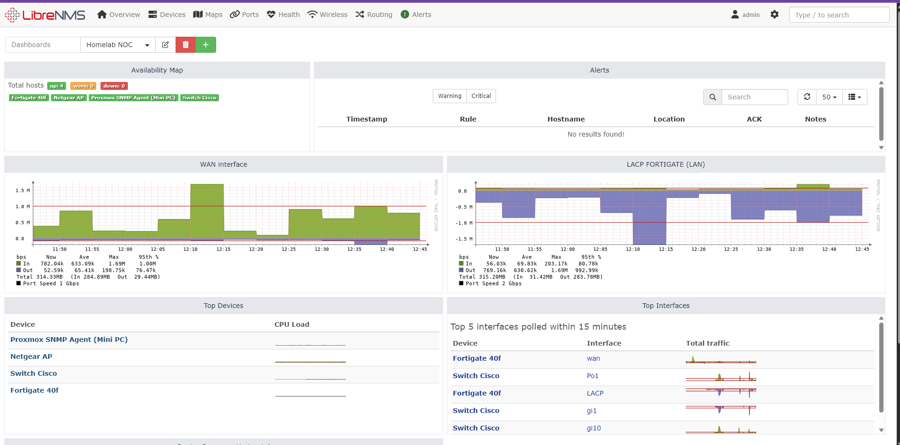

| | |
|---|---|
| **Server** | LibreNMS in an LXC container on Proxmox VE (`192.168.10.111`) |
| **Protocol** | SNMP v2c, read-only, UDP/161 |
| **Devices** | 4 (firewall, switch, hypervisor, wireless AP) |
| **Alerting** | Telegram bot, HTML template, one reusable alert operation |
| **Outcome** | 4/4 devices up, 69 ports (14 ignored), 82 sensors, no active alerts |
| **Tested** | SNMP polling captured on the wire; one LACP member link unplugged and restored with `ALERT` and `RESOLVED` received in Telegram |

## Contents

1. [Overview](#1-overview)
2. [Architecture](#2-architecture)
3. [LibreNMS installation and initial setup](#3-librenms-installation-and-initial-setup)
4. [Proxmox host SNMP agent](#4-proxmox-host-snmp-agent)
5. [Adding network devices](#5-adding-network-devices)
6. [Noise reduction](#6-noise-reduction)
7. [Telegram alerting](#7-telegram-alerting)
8. [Dashboard](#8-dashboard)
9. [Result](#9-result)
10. [Testing and troubleshooting](#10-testing-and-troubleshooting)
11. [Security notes](#11-security-notes)

**Prerequisites:** a Proxmox VE host with room for one LXC (2 vCPU, 4 GB RAM, 64 GB disk), devices reachable on `192.168.10.0/24` with SNMP v2c available, and a Telegram account.

---

## 1. Overview

| LibreNMS display name | Device | IP | Notes |
|---|---|---|---|
| `Fortigate 40f` | FortiGate 40F, FortiOS 7.2.11 | `192.168.10.1` | Firewall. WAN (1 Gbps) and LAN LACP trunk (2 Gbps) |
| `Switch Cisco` | Cisco SG300-10PP | `192.168.10.8` | 10-port Gigabit PoE+. LACP (`Po1`) uplink to the FortiGate |
| `Proxmox SNMP Agent (Mini PC)` | Proxmox VE host, kernel 6.17.2-1-pve | `192.168.10.105` | Hosts the LibreNMS LXC. SNMP through `snmpd` |
| `Netgear AP` | WAX214 wireless AP | `192.168.10.108` | Detected by LibreNMS as *EnGenius Access Point* (router mode) |

LibreNMS itself runs at `192.168.10.111`.

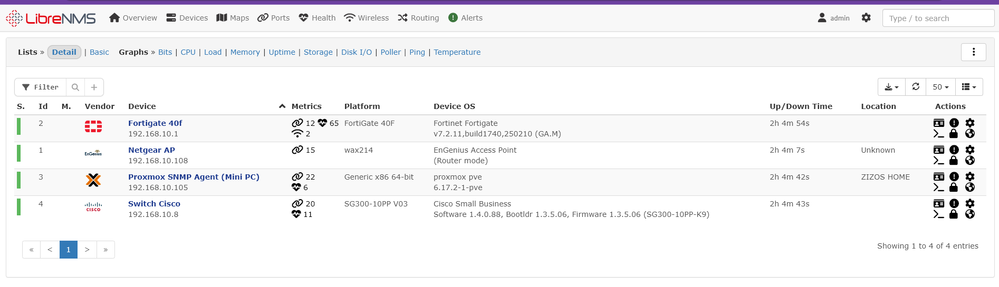

## 2. Architecture

All devices share the `192.168.10.0/24` LAN. LibreNMS polls each one over SNMP v2c and stores the results locally.

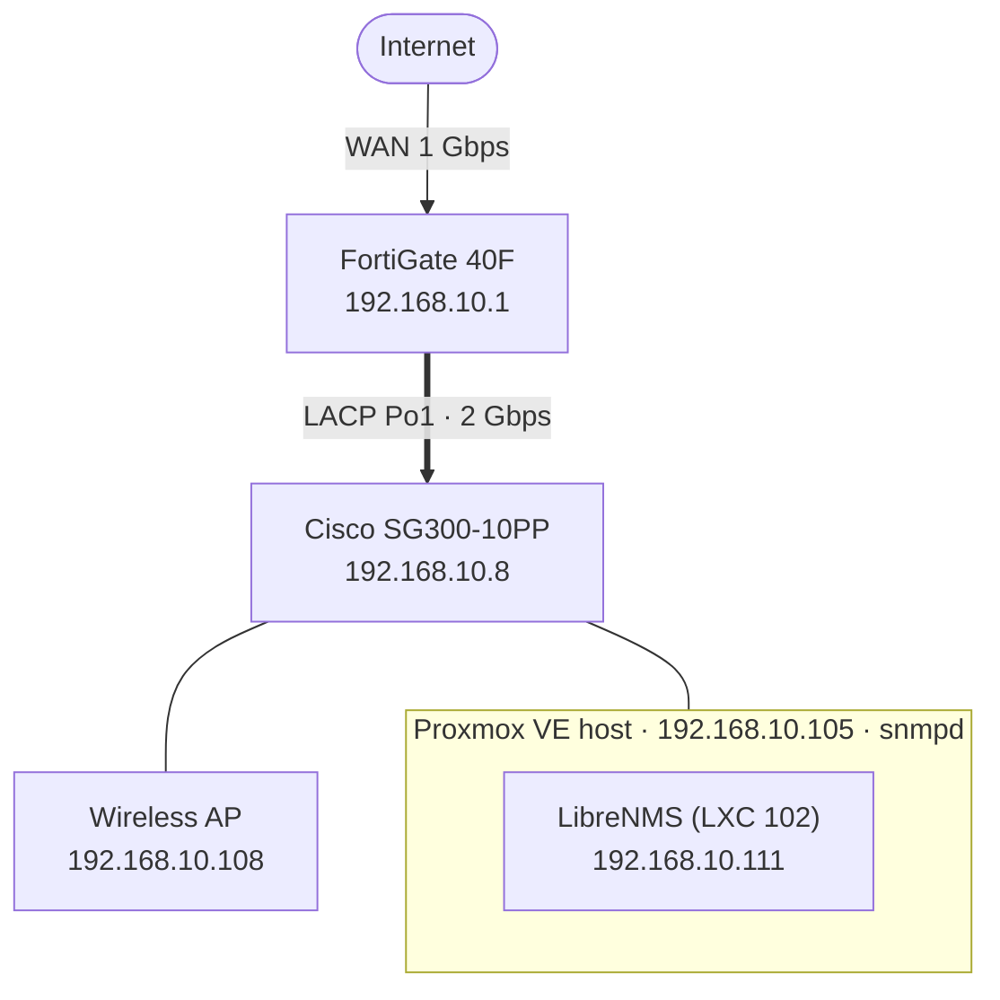

Alert path inside LibreNMS ([official model](https://docs.librenms.org/Alerting/)): a rule raises the alert, an operation decides who is notified and when, a transport delivers it and a template formats the message.

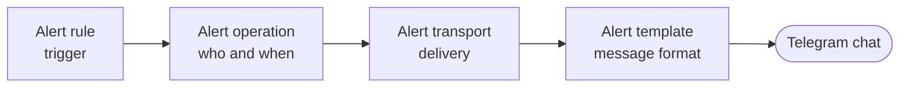

---

## 3. LibreNMS installation and initial setup

> **Why an LXC:** the monitoring server stays isolated from the hypervisor, can be snapshotted or restored on its own, and has a fixed IP that devices can whitelist.

**Container (Proxmox VE)**

| Setting | Value |
|---|---|
| CT ID / hostname | `102` / `NMS` |
| Cores | 2 |
| Memory / swap | 4 GB / 512 MiB |
| Root disk | 64 GB (`local-lvm`) |
| Address | `192.168.10.111/24`, gateway `192.168.10.1` |

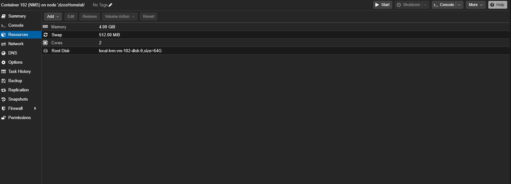

Check addressing, routing and Internet access before installing anything:

```bash
ip address
ip route
ping 1.1.1.1
```

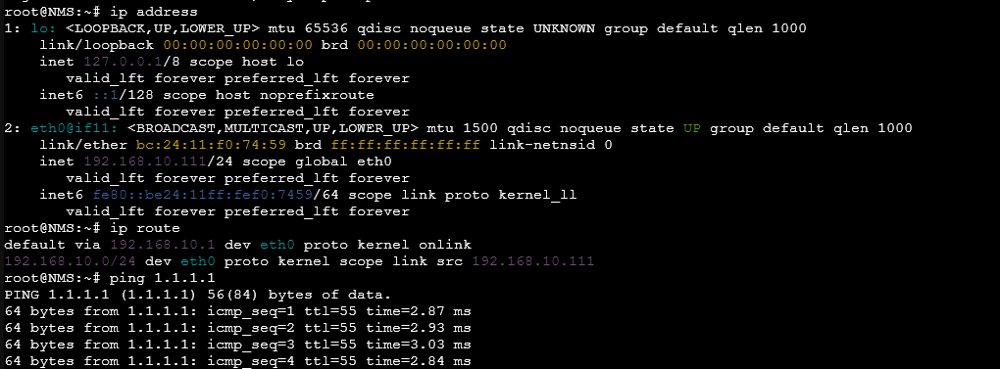

**Dependencies**

```bash
apt update && apt install -y \
  acl ca-certificates curl fping git graphviz imagemagick \
  mariadb-server mariadb-client mtr-tiny nginx nmap \
  php-fpm php-cli php-curl php-gd php-gmp php-mbstring \
  php-mysql php-snmp php-xml php-zip php-bcmath php-intl \
  php-pear python3-dotenv python3-pymysql python3-redis \
  python3-setuptools python3-systemd python3-urllib3 \
  rrdtool snmp snmpd unzip whois
```

**Installation.** Follow the [official installation guide](https://docs.librenms.org/Installation/Install-LibreNMS/). In short:

1. Create the `librenms` system user, clone the repository to `/opt/librenms` and set ownership and ACLs.
2. Install PHP dependencies as `librenms` with `./scripts/composer_wrapper.php install --no-dev`.
3. Create the database and enable the required MariaDB options (`innodb_file_per_table=1`, `lower_case_table_names=0`):

   ```sql
   CREATE DATABASE librenms CHARACTER SET utf8mb4 COLLATE utf8mb4_unicode_ci;
   CREATE USER 'librenms'@'localhost' IDENTIFIED BY '<DB_PASSWORD>';
   GRANT ALL PRIVILEGES ON librenms.* TO 'librenms'@'localhost';
   FLUSH PRIVILEGES;
   ```

4. Set the PHP timezone, create the `librenms` php-fpm pool and the nginx server block, then install the cron and logrotate files.
5. Open `http://192.168.10.111/install` and complete the web installer.

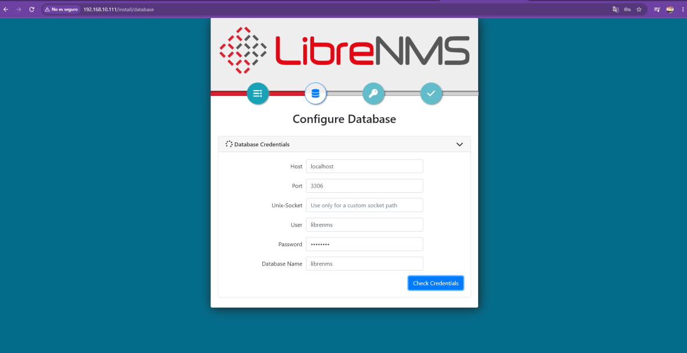

| Installer field | Value |
|---|---|
| Host / port | `localhost` / `3306` |
| User / database | `librenms` / `librenms` |
| Password | `********` |

**Global setting: `uptime_warning`.** LibreNMS flags a device as *warning* when its uptime is below this threshold (default `86400` s, 24 h). Homelab devices reboot often, so the value is lowered to `300` s to keep freshly rebooted devices green in the availability map. Set it in `Global Settings` (gear icon) → `Web UI` → `Device Settings` → *Show Device as warning if Uptime below (seconds)*.

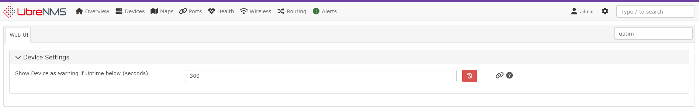

---

## 4. Proxmox host SNMP agent

> **Why:** LibreNMS can only poll what an agent serves. Proxmox VE has no SNMP agent enabled by default, so the host runs `snmpd` (Debian base). A source-restricted, read-only community limits exposure.

```bash
apt install snmpd
```

Edit `/etc/snmp/snmpd.conf`:

```conf
# Listen on all interfaces, UDP/161 (the stock config binds to loopback only)
agentaddress udp:161

# Read-only community, answered only to the LibreNMS server
rocommunity <COMMUNITY> 192.168.10.111

# Shown in the LibreNMS device overview
sysLocation Homelab
sysContact  admin@example.com

# Comment out the stock "rocommunity public ..." and "rocommunity6 public ..." lines
```

Restart and enable the service:

```bash
systemctl restart snmpd
systemctl enable snmpd
```

Verify from the LibreNMS LXC:

```bash
snmpwalk -v2c -c <COMMUNITY> 192.168.10.105 sysDescr
```

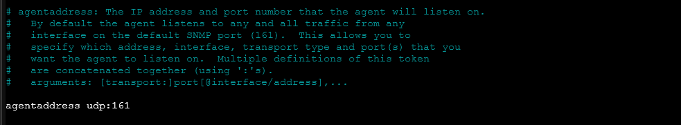
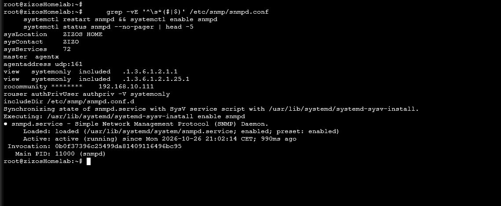

---

## 5. Adding network devices

> **Why:** every device needs SNMP enabled, a read-only community that matches the one stored for it in LibreNMS (communities are case-sensitive), and permission for `192.168.10.111` to query it. Display names keep dashboards and alerts readable.

**5.1 Enable SNMP v2c on each device**

| Device | Where | What to set |
|---|---|---|
| FortiGate 40F | `Network → Interfaces` | On the interface LibreNMS reaches (`lan`), tick **SNMP** under Administrative Access |
| | `System → SNMP` | Enable the agent, create a v1/v2c community with v2c queries enabled and v1 disabled, allow host `192.168.10.111/32` |
| Cisco SG300 | `SNMP → Communities` | Add a community: type *Basic*, access mode *Read Only*, management station `192.168.10.111` |
| Wireless AP | SNMP settings page | Enable SNMP and set the read-only community |

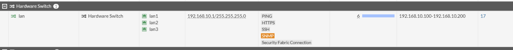
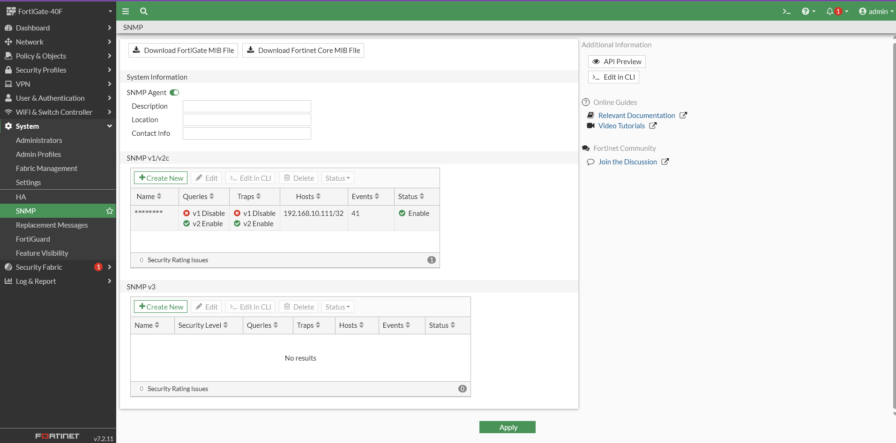
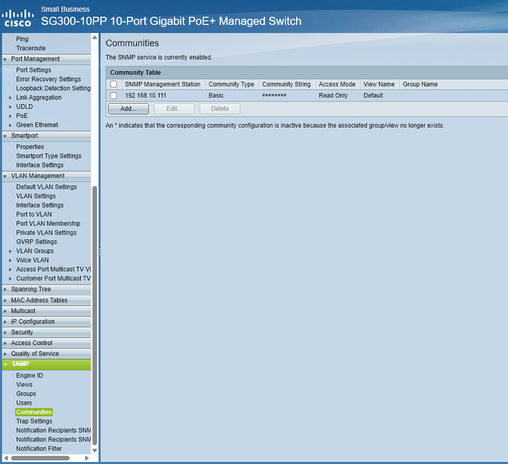
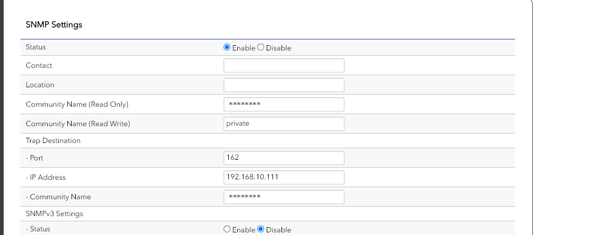

**5.2 Add the devices in LibreNMS**

`Devices → Add Device`, once per device:

| Field | Value |
|---|---|
| Hostname or IP | device IP |
| SNMP | ON |
| SNMP Version | `v2c` |
| Transport | `udp` (default port) |
| Community | `********` |

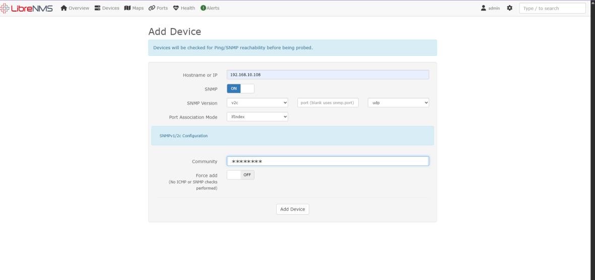

CLI alternative: `lnms device:add <hostname or ip>` (see `lnms device:add --help` for the SNMP options).

**5.3 Set display names**

`Device → Edit → Display Name`. The names appear in dashboards and alert messages instead of raw IPs. The final list is shown in [Overview](#1-overview).

**5.4 Verify SNMP on the wire (optional).** A packet capture confirms that LibreNMS polls each device and shows what the traffic looks like. The SG300 mirrors one port to a laptop running Wireshark (`Port and VLAN Mirroring`):

| Field | Value |
|---|---|
| Destination port | `GE4` (laptop with Wireshark) |
| Source interface | Port `GE3` (mini PC running Proxmox VE, the LibreNMS LXC and the other services) |
| Type | Tx and Rx |

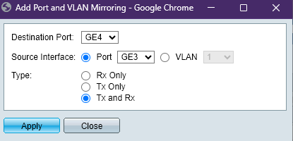

Capture with the display filter `snmp`:

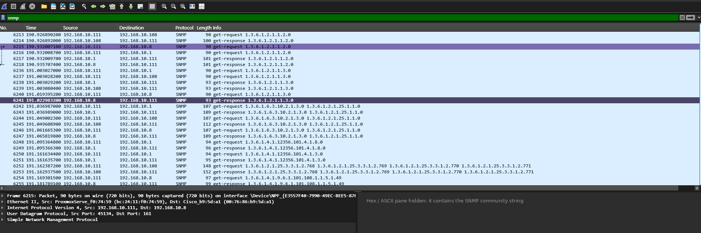

What the capture shows:

- `192.168.10.111` sends `get-request` packets to `192.168.10.1`, `192.168.10.8` and `192.168.10.108`, and each one receives a `get-response`.
- The traffic is SNMP v2c to UDP port 161.
- 7006 packets captured, 626 shown by the `snmp` filter, 0 lost.
- Example: request 6216 to the FortiGate is answered by packet 6217 with `error-status: noError` and `sysObjectID` (`1.3.6.1.2.1.1.2.0`) = `1.3.6.1.4.1.12356.101.1.441`, which sits under Fortinet's enterprise branch.
- Polling of the Proxmox host (`192.168.10.105`) is not expected on the mirrored port, because LibreNMS runs on that same host.

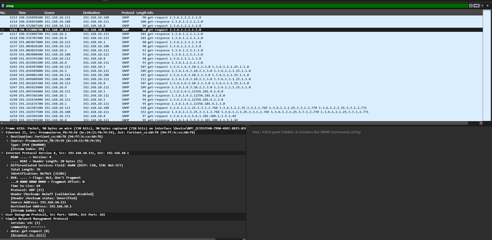
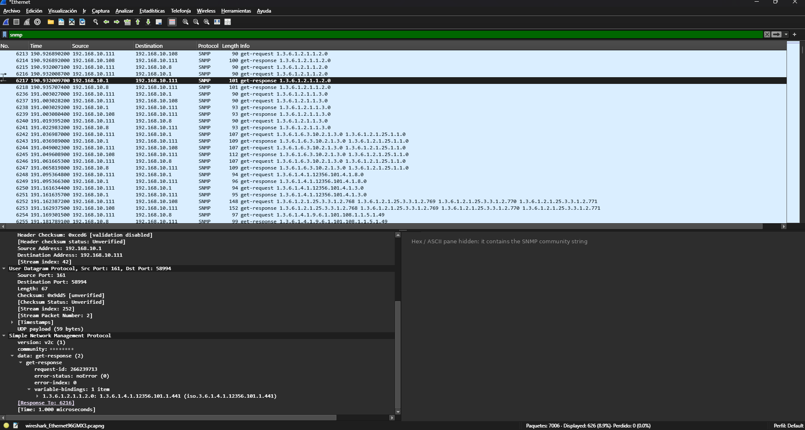

The community string travels in clear text and is readable by anyone who can capture the traffic. It is masked in these screenshots. See [Security notes](#11-security-notes).

---

## 6. Noise reduction

> **Why:** an alert that is always on gets ignored. Anything that is down by design must not page you.

**6.1 Unused ports.** The *Port status up/down* rule fires for every port in `down` state. Ports without a cable and unrouted SVIs are marked **IGNORE** in `Device → Edit → Ports`. Polling continues, alerts stop.

| Device | Ignored ports |
|---|---|
| Fortigate 40f | `lan1`, `a`, `lan`, `fortilink` |
| Switch Cisco | `gi4` to `gi8`, VLAN interfaces `10`, `20`, `30`, `99`, `999` |

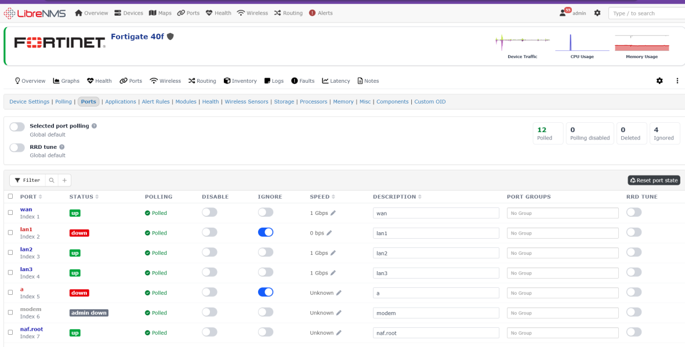
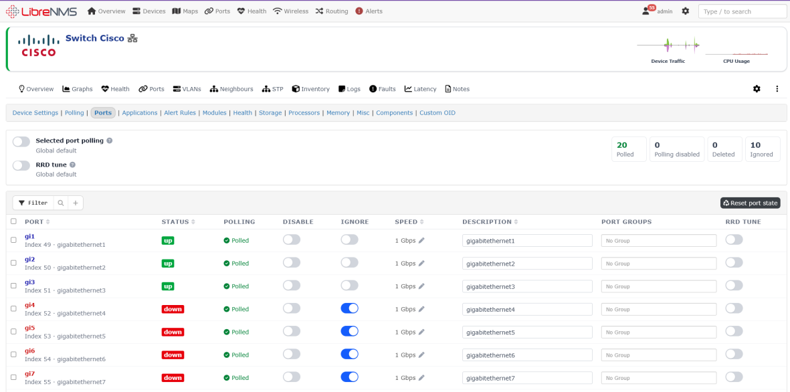

**6.2 FortiGate license sensors.** FortiOS exposes one *Days left for ...* sensor per subscription service (30 in total). Without an active Fortinet contract they sit at `-295` days and keep *Sensor under limit* firing. Alerts are switched **OFF** for each of them in `Device → Edit → Health`.

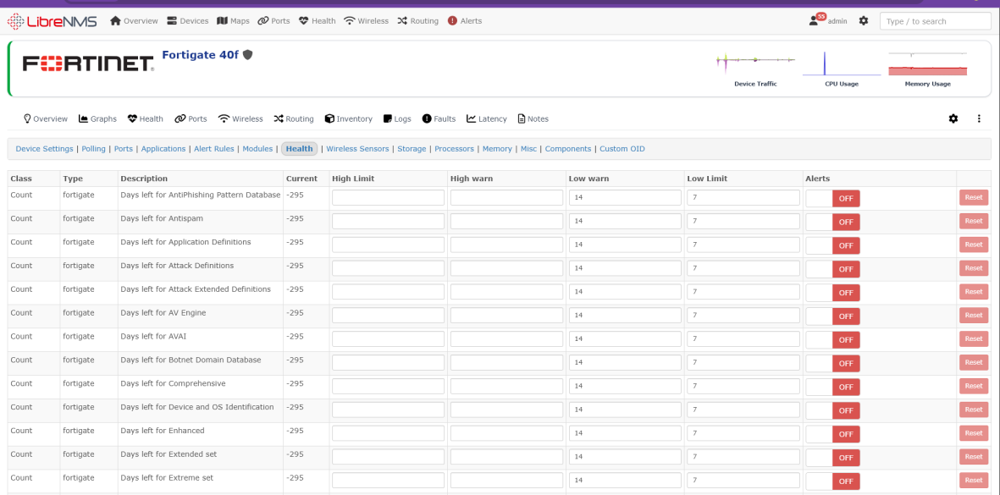

---

## 7. Telegram alerting

> **Why:** push notifications reach the phone immediately. The operation is defined once and reused by every rule, and the template keeps each message short enough to read at a glance.

**7.1 Bot and chat ID**

1. In Telegram, talk to `@BotFather`, send `/newbot` and keep the token.
2. Send `/start` to the new bot.
3. Read the chat ID from `https://api.telegram.org/bot<BOT_TOKEN>/getUpdates` (`"chat":{"id":...}`).


**7.2 Alert transport.** `Alerts → Alert Transports → Create alert transport`

| Field | Value |
|---|---|
| Transport name | `Bot` |
| Transport type | Telegram |
| Default Alert | ON |
| Chat ID | `<CHAT_ID>` |
| Thread ID | empty |
| Token | `********` |
| Format | HTML |
| Send PNG Graph as | photo |

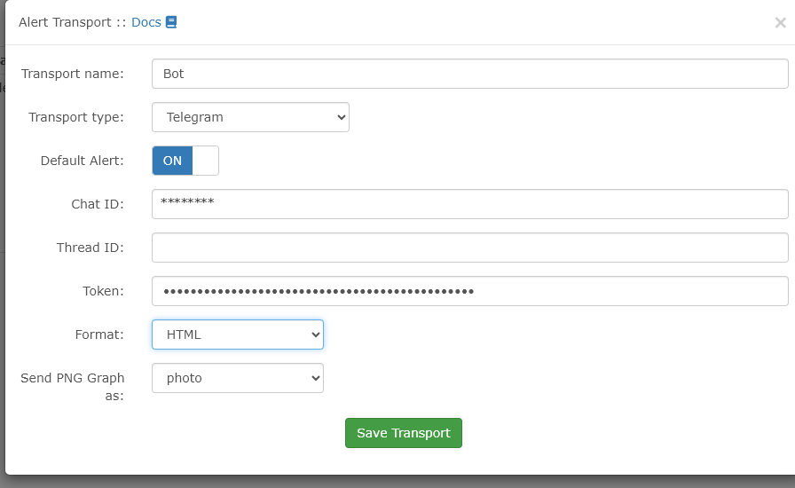

Use the *Test transport* button to confirm delivery.

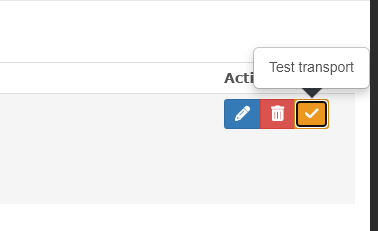


**7.3 Alert operation.** `Alerts → Alert Operations → Create operation`. A rule without an operation raises the alert but sends nothing.

| Field | Value |
|---|---|
| Name | `Send to telegram` |
| Default step duration | `300` s |
| Suppress notifications | OFF |
| Segment | steps `1` to `1`, start `1` s, step duration `300` s |
| Transports / groups | `Telegram: Bot` |

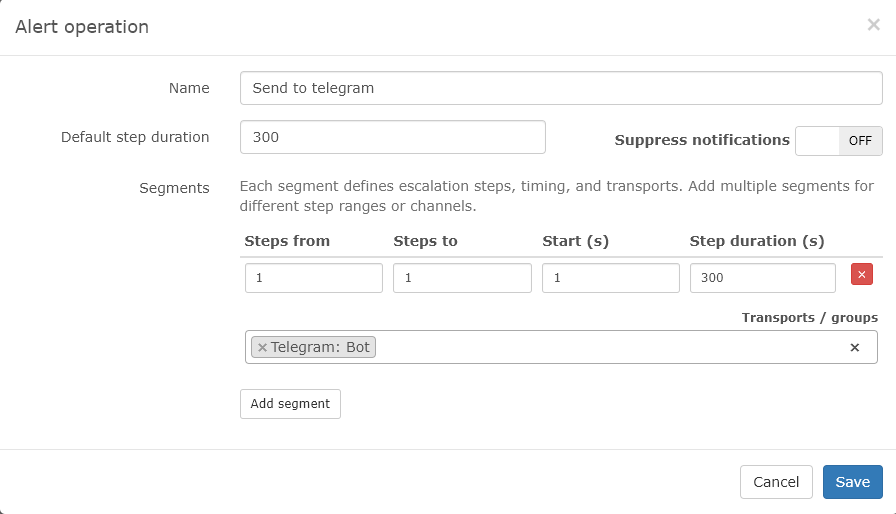

**7.4 Alert rules.** Each rule is linked to the operation through its **Operation** field.

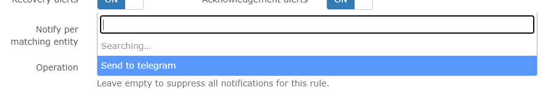

| Rule | Condition | Severity |
|---|---|---|
| CPU usage above 90% | `macros.device_up = 1 AND processors.processor_usage >= 90` | Warning |
| RAM usage above 90% | `macros.device_up = 1 AND mempools.mempool_perc >= 90` | Warning |
| Storage usage above 80% | `storage.storage_perc >= 80` | Warning |
| Device Down (SNMP unreachable) | `macros.device_down = 1 AND devices.status_reason LIKE '%snmp%'` | Critical |
| Device Down! Due to no ICMP response. | `macros.device_down = 1 AND devices.status_reason LIKE '%icmp%'` | Critical |
| Device rebooted | `devices.uptime < 300 AND macros.device = 1` | Critical |
| Ping Latency | `device_stats.ping_rtt_last > 60` | Critical |
| Port status up/down | `macros.port_down = 1` | Critical |
| Port utilisation over threshold | `macros.port_usage_perc >= 80 AND macros.port_up = 1` | Critical |
| Sensor over limit | `sensors.sensor_current > sensors.sensor_limit AND sensors.sensor_alert = 1 AND macros.device_up = 1` | Critical |
| Sensor under limit | `sensors.sensor_current < sensors.sensor_limit_low AND sensors.sensor_alert = 1 AND macros.device_up = 1` | Critical |
| Service up/down | `services.service_status != 0 AND macros.device_up = 1` | Critical |
| State Sensor Critical | `macros.state_sensor_critical = 1 AND sensors.sensor_alert = 1` | Critical |
| Wireless Sensor over limit | `wireless_sensors.sensor_current >= wireless_sensors.sensor_limit AND wireless_sensors.sensor_alert = 1 AND macros.device_up = 1` | Critical |
| Wireless Sensor under limit | `wireless_sensors.sensor_current <= wireless_sensors.sensor_limit_low AND wireless_sensors.sensor_alert = 1 AND sensors.group != "License expiration"` | Critical |

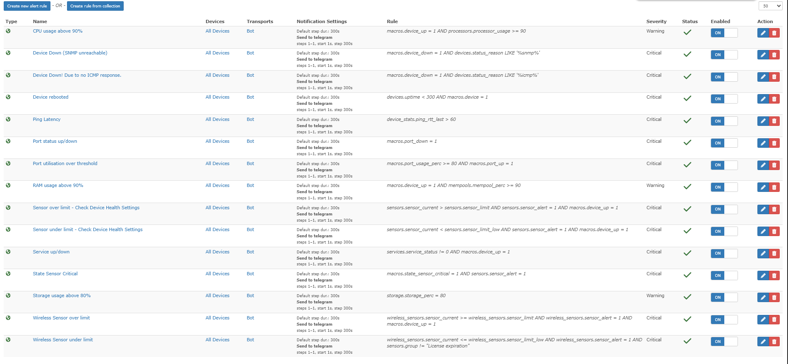

**7.5 Minimalist template.** The default message is verbose and prints raw SNMP fields (`sysObjectID`, `snmpEngineID`, ...).

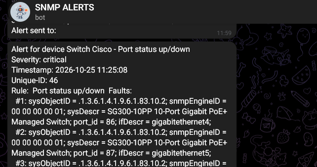

Replace it in `Alerts → Alert Templates → Default Alert Template`. The template prints the state, rule name, host, time, and one line per faulty port, sensor, disk, RAM or CPU entry. Port lines show `down` in an `ALERT` and `up` in a `RESOLVED` message (the template checks `$alert->state`).

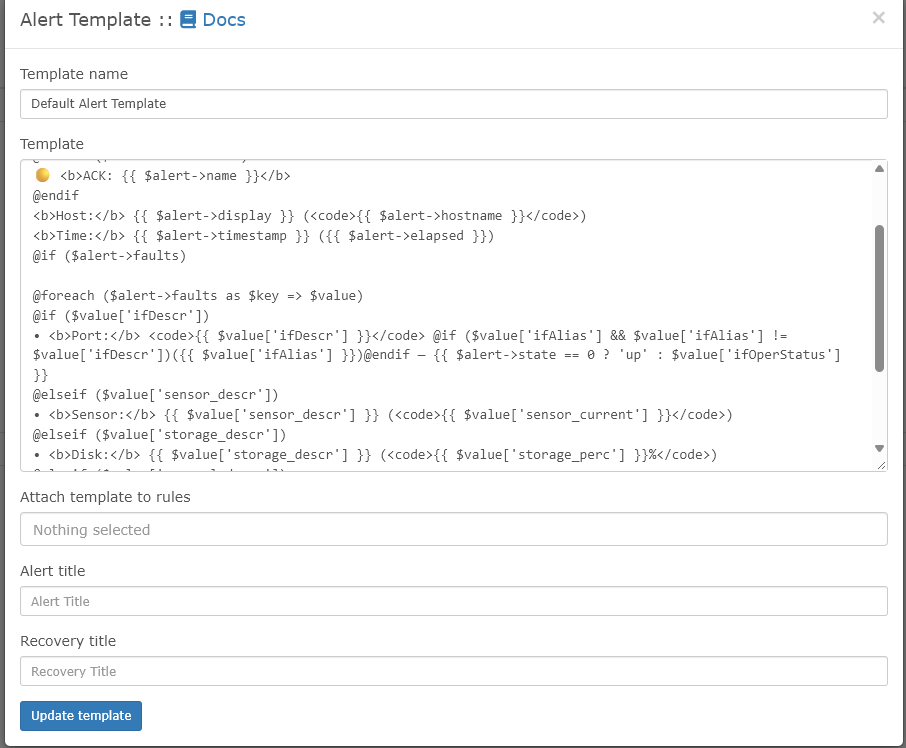

<details>
<summary>Alert template (Blade, HTML format)</summary>

```html
@if ($alert->state == 0)
🟢 <b>RESOLVED: {{ $alert->name }}</b>
@elseif ($alert->state == 1)
🔴 <b>ALERT: {{ $alert->name }}</b>
@elseif ($alert->state == 2)
🟡 <b>ACK: {{ $alert->name }}</b>
@endif
<b>Host:</b> {{ $alert->display }} (<code>{{$alert->hostname }}</code>)
<b>Time:</b> {{ $alert->timestamp }} ({{$alert->elapsed }})
@if ($alert->faults)

@foreach ($alert->faults as $key =>$value)
@if ($value['ifDescr'])
• <b>Port:</b> <code>{{ $value['ifDescr'] }}</code> @if ($value['ifAlias'] && $value['ifAlias'] !=$value['ifDescr'])({{ $value['ifAlias'] }})@endif — {{ $alert->state == 0 ? 'up' : $value['ifOperStatus'] }}
@elseif ($value['sensor_descr'])
• <b>Sensor:</b> {{ $value['sensor_descr'] }} (<code>{{$value['sensor_current'] }}</code>)
@elseif ($value['storage_descr'])
• <b>Disk:</b> {{ $value['storage_descr'] }} (<code>{{$value['storage_perc'] }}%</code>)
@elseif ($value['mempool_descr'])
• <b>RAM:</b> {{ $value['mempool_descr'] }} (<code>{{$value['mempool_perc'] }}%</code>)
@elseif ($value['processor_descr'])
• <b>CPU:</b> <code>{{ $value['processor_usage'] }}%</code>
@endif
@endforeach
@endif
```

</details>

Result in Telegram:

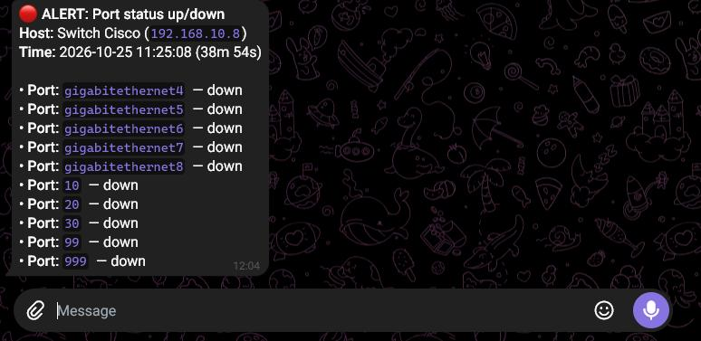

**7.6 End-to-end test: unplug an LACP member link.** To validate the whole chain (polling, rule, operation, transport and template), one member link of the FortiGate–SG300 LACP bundle was unplugged on purpose and then plugged back in. The two ends of that link are FortiGate `lan2` and Cisco `gigabitethernet9`. The test was run twice: the Faults page capture comes from the first run (13:05), and the Telegram captures from the second run, after the final template was applied.

| Step | Observed |
|---|---|
| Link unplugged | `Port status up/down` raised on both devices: `Fortigate 40f` / `lan2` at 21:20:06 and `Switch Cisco` / `gigabitethernet9` at 21:20:08 |
| LibreNMS | Both faults listed on the Faults page |
| Telegram | One `ALERT` message per device, each naming the port as `down` |
| Link restored | One `RESOLVED` message per device at 21:25:06 and 21:25:09, with alert durations of 5m and 5m 1s, each naming the port as `up` |

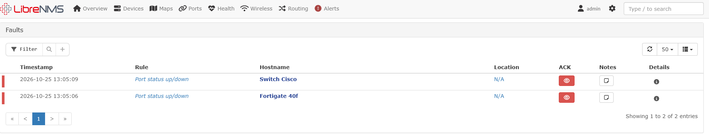
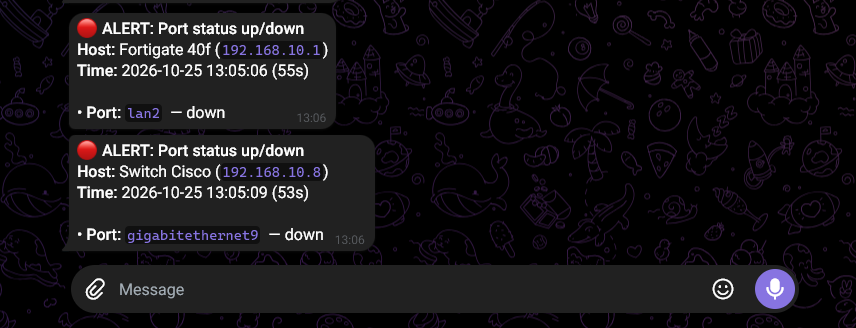
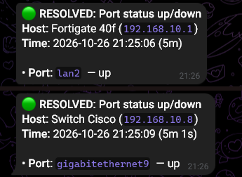

Notes:

- Port state is detected on the polling cycle (5 minutes by default), so expect up to that delay between unplugging a cable and the alert.
- `ALERT` messages print the port as `down`; `RESOLVED` messages print the recovered port as `up`.

---

## 8. Dashboard

> **Why:** one screen answers "is everything up, and is anything busy or alerting?"

A single dashboard, **Homelab NOC**, built from LibreNMS widgets: `Overview → Dashboards → +`, then *Edit* to add widgets.

| Widget | Content |
|---|---|
| Availability Map | Up / warning / down state of the four devices |
| Alerts | Active alerts (empty when healthy) |
| Graph: *WAN interface* | FortiGate `wan` port (1 Gbps) |
| Graph: *LACP FORTIGATE (LAN)* | FortiGate LACP trunk (2 Gbps) |
| Top Devices | CPU load per device |
| Top Interfaces | Busiest interfaces in the last 15 minutes |
| Device Summary Horizontal | Device, port and health totals |

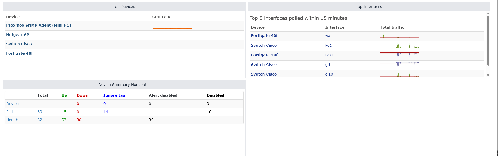

---

## 9. Result

| Item | Status |
|---|---|
| Devices | 4 total, 4 up, 0 down |
| Ports | 69 total, 45 up, 14 ignored |
| Health sensors | 82 total, 30 with alerts disabled (FortiGate license counters) |
| Active alerts | none |
| End-to-end alert test | LACP member link unplugged and restored: `ALERT` then `RESOLVED` in Telegram for both devices ([section 7.6](#7-telegram-alerting)) |
| SNMP on the wire | Port mirror and Wireshark: requests and `noError` responses between LibreNMS and the three LAN devices ([section 5.4](#5-adding-network-devices)) |

CPU polling per device (`Health → Processor`) and the switch overview confirm that data is being collected:

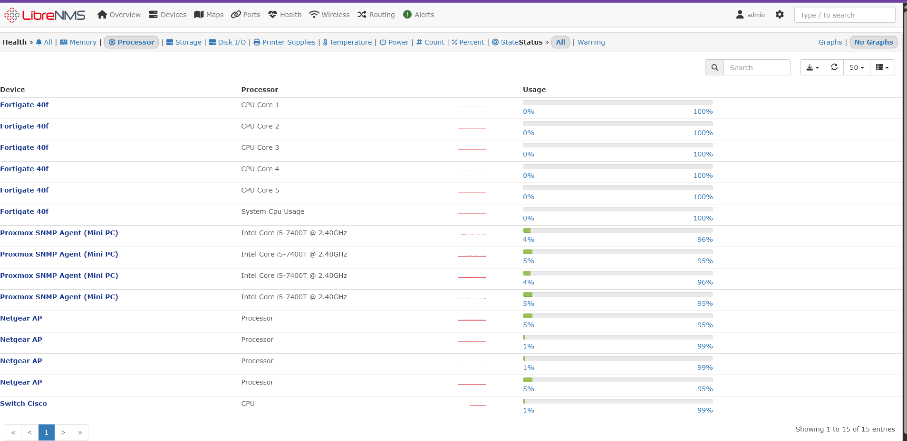
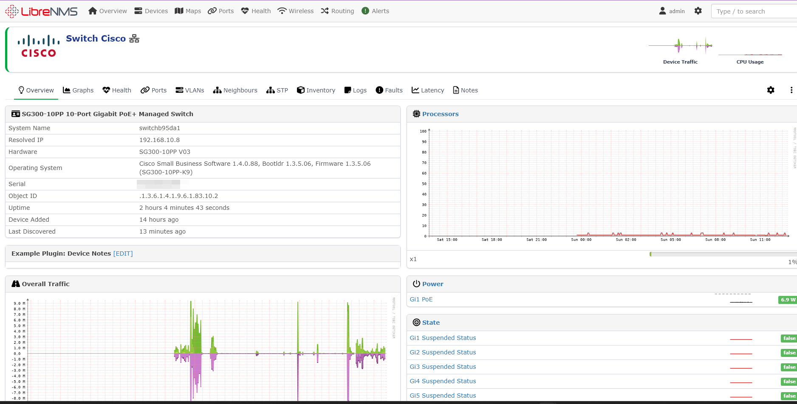

---

## 10. Testing and troubleshooting

A physical test (unplugging an LACP member link) is documented in [section 7.6](#7-telegram-alerting). Software-side checks, run from `/opt/librenms` on the LXC:

```bash
# Is the installation healthy?
./validate.php

# Force a real alert through the transport
./scripts/test-alert.php -r <rule_id> -h <hostname_or_device_id> -d

# Render a template against a device and a rule
./scripts/test-template.php -t <template_id> -d -h <hostname> -r <rule_id>
```

`test-template.php` renders the alert case only. To check a `RESOLVED` message, restore a real fault as in [section 7.6](#7-telegram-alerting).

| Symptom | Check |
|---|---|
| Device shows *warning* right after a reboot | `uptime_warning` threshold ([section 3](#3-librenms-installation-and-initial-setup)) |
| Device added but no SNMP data | `snmpwalk -v2c -c <COMMUNITY> <device-ip> sysDescr` from the LXC. Verify the community, the allowed host `192.168.10.111`, and (FortiGate) SNMP on the interface |
| Alert appears in LibreNMS but nothing reaches Telegram | The rule has no operation assigned, or *Test transport* fails |
| Threshold rule (CPU, RAM, storage) never fires | The operator must be `greater or equal`. `equal` only matches the exact value |
| Permanent alerts for ports or sensors that are down by design | [Noise reduction](#6-noise-reduction) |

References: [alerting tests](https://docs.librenms.org/Alerting/Testing/), [FAQ](https://docs.librenms.org/Support/FAQ), [alert operations](https://docs.librenms.org/Alerting/Operations/).

## 11. Security notes

- Use read-only communities and restrict them to the LibreNMS IP (`rocommunity <COMMUNITY> 192.168.10.111`, allowed host on the FortiGate and the SG300).
- Do not keep default strings (`public`, `private`). The wireless AP also exposes a read-write community: leave it unset or non-default.
- SNMP v2c sends the community in clear text (the capture in [section 5.4](#5-adding-network-devices) shows it). Keep UDP/161 inside the LAN. SNMPv3 is the upgrade path.
- Mask communities, bot tokens and chat IDs in screenshots (`********`).

## Repository layout

```text
.
├── README.md
└── images/      # screenshots referenced above
```
